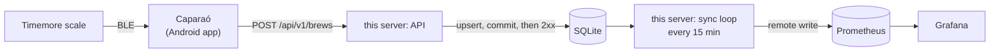

# Timemore Dot Prometheus Exporter


The server for the [Caparaó](https://github.com/MateuxLucax/caparao) Android app, which records
espresso and filter brews from a Timemore scale. It receives each brew over HTTP, stores it in
SQLite, and copies it to Prometheus with the
[remote write](https://prometheus.io/docs/specs/prw/remote_write_spec/) 1.0 protocol, keeping
the brew's original timestamps.



SQLite is the source of truth: the app gets its 2xx as soon as the brew is committed, so a
Prometheus outage never blocks or loses an upload. A sync loop in the same process sends what
Prometheus has not seen yet and only then advances its per-brew checkpoint.

## API

The wire format is the Caparaó upload contract, copied into [`testdata/contract`](testdata/contract)
(see its [README](testdata/contract/README.md)). The same JSON files are tested against the app,
the app repo's stub server and this server.

| Request | Auth | Answer |
|---------|------|--------|
| `POST /api/v1/brews` | Bearer | `201` new brew, `200` existing `id` replaced (brew and all its samples), `400` invalid body, `401` bad token, `413` over 4 MiB, `405` wrong method. Errors are `{"error": "..."}`. 2xx only after the SQLite commit. |
| `GET /api/v1/brews` | Bearer | `200`, every brew without samples (with `sample_count`), newest first. Creates nothing; used by the app's connection test. |
| `GET /api/v1/brews/{id}` | Bearer | `200`, the brew with all its samples in the upload format (samples in upload order), `404` unknown id, `405` other methods. |
| `GET /healthz` | none | `200 ok` |

## Metrics

All carry the labels `mode` (`espresso` or `filter`) and `id` (the brew's UUID; why, see
[ADR 0004](docs/adr/0004-labels-and-cardinality.md)).

| Metric | Timestamp | |
|--------|-----------|---|
| `caparao_brew_yield_grams` | brew end | |
| `caparao_brew_dose_grams` | brew end | |
| `caparao_brew_ratio` | brew end | yield / dose |
| `caparao_brew_duration_seconds` | brew end | end - start |
| `caparao_brew_time_to_first_drop_seconds` | brew end | espresso only |
| `caparao_brew_flow_avg_grams_per_second` | brew end | |
| `caparao_brew_weight_grams` | each sample (`started_at_ms + t_ms`) | the curve |
| `caparao_brew_flow_grams_per_second` | each sample | the curve |

Example queries:

```promql
# Brews per day
sum by (mode) (count_over_time(caparao_brew_yield_grams[1d]))
# Average espresso ratio over the last week
avg_over_time(caparao_brew_ratio{mode="espresso"}[7d])
```

## Configuration

| Variable | Default | |
|----------|---------|---|
| `AUTH_TOKEN` | (required) | Bearer token the app sends. Use a long random value (`openssl rand -hex 32`); shorter than 32 characters logs a warning (fine for `dev-token` in development). |
| `REMOTE_WRITE_URL` | (required) | e.g. `http://prometheus:9090/api/v1/write`. Credentials in the URL are redacted in the log. |
| `LISTEN_ADDR` | `:8080` | |
| `DB_PATH` | `/data/caparao.db` | SQLite file. Created and migrated on start. |
| `SYNC_INTERVAL` | `15m` | Go duration. A sync also runs at start. |

## Commands

```sh
timemore-dot-prometheus-exporter          # serve the API and run the sync loop (default; also "serve")
timemore-dot-prometheus-exporter sync     # one sync now, then exit (exit 1 if Prometheus failed)
timemore-dot-prometheus-exporter resend   # mark every brew unsent and sync: re-sends everything
```

In compose: `docker compose exec exporter /timemore-dot-prometheus-exporter resend`. Re-sending
identical data is harmless: Prometheus accepts a sample identical to one it already has.

## Prometheus requirements

- `--web.enable-remote-write-receiver`.
- `storage.tsdb.out_of_order_time_window` in `prometheus.yml` ([`30d` here](prometheus.yml)).
  Brews arrive late (the phone was offline, the upload retried, the sync runs every 15 minutes)
  and are older than what Prometheus already holds. **Brews older than the window are rejected**
  by Prometheus (`400 too old sample`): the exporter logs
  `WARN sync: brew <id> rejected: ...`, stores the reason in the brew's `sync_error` column and
  does not retry it. The brew stays in SQLite. To load old brews (e.g. after restoring a backup
  into an empty Prometheus) raise the window, then run `resend`.
- A replaced brew (same `id`, new body) is sent again, but Prometheus cannot change a value it
  already stores: changed values at the same timestamps are rejected as duplicates and reported
  the same way. SQLite keeps the corrected brew. See [ADR 0002](docs/adr/0002-remote-write-original-timestamps.md).
- Retention defaults to 15 days; the example sets `--storage.tsdb.retention.time=10y`.

## Run with Docker Compose

```sh
cp docker-compose.example.yml docker-compose.yml
printf 'AUTH_TOKEN=%s\nGRAFANA_ADMIN_PASSWORD=%s\n' "$(openssl rand -hex 32)" "$(openssl rand -hex 16)" > .env
docker compose up -d
```

- The exporter listens on port 8080. In the app, set the server to e.g.
  `https://coffee.example.com` (behind a reverse proxy) and the same token.
- Grafana is on `http://localhost:3000` (user `admin`, password from `.env`) with the
  Prometheus datasource and the **Caparaó brews** dashboard provisioned: brews per day, yield /
  dose, ratio and duration per brew, and the weight and flow curves (pick a brew in the `id`
  variable or zoom into it).
- Back up the `exporter-data` volume: it is the source of truth. Prometheus can be rebuilt from
  it with `resend` (within the out-of-order window).

To build the image from source, replace `image:` with `build: .` in the compose file, or
`docker build -t timemore-dot-prometheus-exporter .` The image is distroless, static (no cgo)
and runs as a non-root user.

## Security

- Use HTTPS (a reverse proxy) whenever the phone does not reach the server over a trusted LAN,
  in particular from the internet. The server speaks plain HTTP.
- The token is compared in constant time (SHA-256 of both sides, `subtle.ConstantTimeCompare`)
  and never logged. Access log lines show method, path, status and the brew id only.
- Prometheus and Grafana have no published ports beyond localhost in the example; Prometheus
  has no authentication.
- Bodies are limited to 4 MiB and validated strictly before anything is stored.

## Development

```sh
go vet ./... && go test ./...
AUTH_TOKEN=dev-token REMOTE_WRITE_URL=http://localhost:9090/api/v1/write DB_PATH=./dev.db go run .
```

`main.go` (configuration, subcommands, wiring) stays at the root; the logic is in `internal/`:
`brew` (validation), `store` (SQLite), `api` (HTTP), `syncer` (sync loop), `remotewrite`
(Prometheus client). See [Architecture](docs/architecture.md).

### Contract files

`testdata/contract` is a copy of `contract/` in the Caparaó repository. When the contract
changes there, re-copy it and run the tests:

```sh
scripts/sync-contract.sh ../caparao && go test ./...
```

### Integration test

`integration_test.go` (build tag `integration`) runs the compiled binary against a real
Prometheus. With Docker:

```sh
scripts/integration.sh
```

or against a Prometheus you started with `--web.enable-remote-write-receiver` and this repo's
`prometheus.yml`:

```sh
PROMETHEUS_URL=http://localhost:9090 go test -tags integration -count=1 -run TestIntegration .
```

Without `PROMETHEUS_URL` it is skipped. It checks summaries at the brew's end time and the curve
at each sample's time, that `resend` duplicates nothing, and that a brew older than the window is
reported as rejected.

## Documentation

- [Architecture](docs/architecture.md): components, sync and checkpoint, deployment
- [Decision records](docs/adr/README.md)
- [Acceptance checklist](docs/acceptance.md): the Caparaó roadmap's stage 8 criteria and how each was verified

## License

[MIT](LICENSE)
