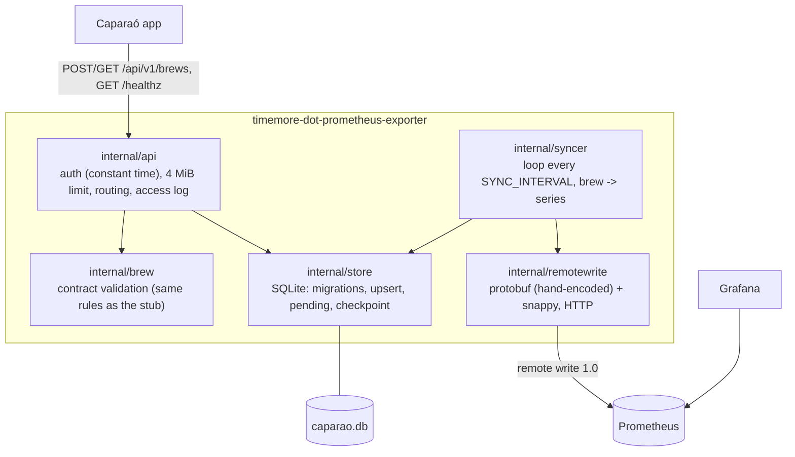

# Architecture

## Components

One binary, one process. `package main` (`main.go`) reads the environment, opens the database
and starts the HTTP server and the sync loop ([ADR 0001](adr/0001-sqlite-source-of-truth-and-sync-loop.md)).



## Data

`brews` holds one row per brew id with the contract fields plus `received_at_ms`, `version`
(bumped by every upsert), `sent_version`, `sent_at_ms` and `sync_error`. `samples` holds the
curve, `(brew_id, seq)` keyed, in upload order. Schema migrations are a list in
`internal/store/store.go`; `PRAGMA user_version` stores how many were applied. The connection
uses WAL, `busy_timeout`, `synchronous=FULL` and immediate write transactions, so the `sync` and
`resend` subcommands can run next to the server against the same file.

## Upload

```mermaid
sequenceDiagram
    participant App
    participant API
    participant DB as SQLite
    App->>API: POST /api/v1/brews (Bearer)
    API->>API: token, size, validation
    API->>DB: BEGIN; delete samples; upsert brew (version+1); insert samples; COMMIT
    API-->>App: 201 new / 200 replaced
```

## Sync and checkpoint

```mermaid
sequenceDiagram
    participant Loop as Sync loop
    participant DB as SQLite
    participant P as Prometheus
    loop every SYNC_INTERVAL (and at start)
        Loop->>DB: brews with version > sent_version (oldest end first)
        Loop->>DB: read brew + samples + version in one transaction
        Loop->>P: remote write (summaries at end, curve at sample times)
        alt 2xx
            Loop->>DB: sent_version = version read (only if unchanged)
        else 400 (rejected for good)
            Loop->>P: each series alone, so the good ones still land
            Loop->>DB: sent_version = version, sync_error = reason (WARN logged)
        else network error, 5xx, 404, 429...
            Loop-->>Loop: stop the run; this and later brews stay pending
        end
    end
```

- A brew replaced while being sent keeps its newer version pending (`UPDATE ... WHERE version = ?`).
- Prometheus down: the run fails, nothing is advanced, the API keeps accepting; the next run
  sends everything once.
- A brew ending more than 1 hour in the future (wrong phone clock) is not sent and recorded as
  rejected: it would move Prometheus' head forward and make later brews "too old".
- `resend` sets every `sent_version` to 0 and syncs.

## Deployment

`docker-compose.example.yml`: the exporter (port 8080, volume `exporter-data` at `/data`),
Prometheus (remote write receiver, 30d out-of-order window, 10y retention, not published) and
Grafana (localhost only, provisioned datasource and dashboard from `grafana/`). Put a reverse
proxy with HTTPS in front of the exporter if the phone reaches it over the internet.
